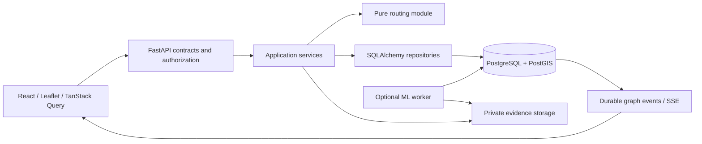

# Architecture

Status: implemented through Phase 7 and independently reviewed in Phase 8, 2026-10-13. See [project status](PROJECT_STATUS.md) and the [final audit](FINAL_ENGINEERING_AUDIT.md) for executed evidence and limits. The dependency candidate table below is historical Phase 0 design; installed lockfiles and the subsequent ADRs are authoritative. [Assumptions](RISK_REGISTER.md) and [ADRs](adr/README.md) identify constraints and alternatives.

## Scope and boundaries

Start with one clearly fictional campus and a small, connected walking network. Data includes stairs, ramps, accessible entrances, unknown attributes, uneven surfaces, and blocked paths. No real-campus surveying or indoor multi-floor routing is implied. Store floor/level now to prevent invalid connections; do not infer elevator connectivity or travel time without verified records.

The modular monorepo has one deployable FastAPI application. PostgreSQL/PostGIS is authoritative for identities, infrastructure, reports, graph revisions, sessions, and durable events. There is no Redis, message broker, microservice mesh, paid map API, or route-result cache. The implemented optional ML worker polls leased database jobs; it remains disabled without approved data/evaluated product weights, and core navigation does not depend on it.

API adapters validate requests and enforce authentication. Services enforce transaction boundaries and domain rules; repositories load/write records. Routing takes an immutable in-memory graph and profile, returning a domain result without ORM/HTTP objects. Frontend components consume typed service responses; Leaflet renders backend geometry and never chooses the route. Analytics reads persisted records using definitions in the API contract.

## Runtime and dependency baseline

Use Python 3.12.14 and Node 24.19.0, both observed on the cloud host; `.python-version` and `.nvmrc` record them. PostgreSQL 17 + PostGIS 3.5 is the database baseline; use an explicitly versioned Docker image and resolve its digest in Phase 1. Native macOS Python/Node plus Compose database is the primary local workflow. Linux/amd64 emulation is a documented fallback if the selected PostGIS image lacks arm64 support; inspect the actual manifest before selecting it.

Registry metadata queried on 2026-10-12 supplies these stable candidate releases:

| Module | Selected candidate | Compatibility basis / gate |
| --- | --- | --- |
| React / React DOM | 19.3.0 / 19.3.0 | Matching versions; Leaflet and Query peers accept React 19 |
| Vite / TypeScript | 8.3.4 / 7.0.2 | Node requirements accept Node 24; plugin/type compatibility must pass Phase 2 build |
| Tailwind | 4.3.3 | Use matching Vite integration; verify shadcn-generated components in Phase 2 |
| React Leaflet / Leaflet | 5.0.0 / 1.9.4 | Published peers: React 19, Leaflet 1.9 |
| TanStack Query | 5.104.2 | Published React peer accepts 18/19 |
| Recharts / Motion | 3.10.1 / 14.1.0 | Published peers include React 19 |
| FastAPI / Pydantic | 0.143.0 / 2.14.1 | Python >=3.10; resolve FastAPI transitive bounds during Phase 1 |
| SQLAlchemy / Alembic / psycopg | 2.1.4 / 1.20.0 / 3.3.6 | Python 3.12 satisfies published Python floors |

Metadata is not an installed compatibility test. Phase 1 pins tested Python dependencies with hashes in `requirements.lock`; Phase 2 commits `package-lock.json` and uses `npm ci`. If integration reveals incompatibility, select a supported stable version and record the reason. Include GeoAlchemy2, Argon2 password support, Pytest/HTTPX and Ruff in Phase 1; Radix/shadcn, Lucide, Vitest/Testing Library and Playwright in Phase 2. Select their exact versions together with the resolver rather than inventing a lock here. PyTorch/torchvision remain an optional separately locked Phase 5 environment after dataset/model selection. Do not download weights in core setup.

## Key design decisions

Phase 2 installed baseline: the npm lock resolves the above UI versions with **TypeScript 5.9.3**, required by openapi-typescript's supported 5.x peer range, plus ESLint 10, Vitest 5 and Playwright 1.64. Strict type/lint/component/browser checks and a production build passed. [ADR-011](adr/011-phase2-frontend.md) records the justified change from the Phase 0 TypeScript candidate. Source Radix/CVA primitives provide the planned shadcn-style composition without generated registry code.

- Database-backed opaque sessions, not browser-stored JWTs: simpler revocation, role changes, and logout for a same-origin first-party application.
- Physical pathway records produce directed graph arcs. A closure of one physical pathway excludes both directions unless a deliberately scoped restriction is recorded.
- WGS84 GeoJSON is the exchange format. Distances use PostGIS geography in metres. Pure routing uses an ECEF chord lower bound for A*, avoiding degrees-as-metres and spherical/spheroidal heuristic mismatch.
- A report verification, its active restrictions, the audit entry, and graph event are one database transaction. Optimistic revisions detect competing edits; a campus graph-state row serializes graph-changing transactions.
- Read graph data and its version under one repeatable-read snapshot. Before returning a calculated route, compare against the latest committed revision and retry once; continuous changes produce an explicit retryable error.
- SSE is a notification channel, not the authoritative graph. Durable replay and version checks repair missed events. The UI never treats an offline route as current.
- Unknown and stale observations retain their meaning. Conservative profiles reject unknown values needed by hard limits, even when general uncertainty is allowed.
- Core mapping renders synthetic GeoJSON with no required external tiles. Licensed external basemaps can be optional later, with attribution and fallback.

## Consistency and failure boundaries

All graph-impacting edits use one service and lock order. No direct admin SQL or CRUD handler bypasses version increments. A successful route says `validated_at`, `graph_version`, `cost_model_version`, and `profile_fingerprint`; these are point-in-time facts, never a safety guarantee. Verification freshness is a versioned 30-day policy using DB UTC time. Graph validity is bounded by the next observation expiry; crossing it triggers the same graph revision/event path before another route is served. [Routing](ROUTING_DESIGN.md) defines exact behavior.

Database outage produces 503 and disables authoritative writes and route calculation. Map tile failure leaves geometry and text available. Upload/inference failure preserves a user's report and exposes evidence/prediction status. Unauthorized operations fail server-side. Stale edits return 409, preserving the previous committed state. Clients retain form input where safe and show actionable retry states.

## Data minimization and operations

No continuous tracking, medical diagnoses, or detailed route history. Accessibility preferences are user-supplied functional constraints. Route calculations are transient; logs omit coordinates, session values, passwords, and image contents. Record structured request IDs, timings, and error codes. Private upload storage is outside the web root, with authorized streaming endpoints. Health distinguishes process liveness from DB/PostGIS readiness. Metrics/logging must not expose personal report evidence.

The local release candidate uses a single API replica, PostgreSQL/PostGIS and private host storage behind a same-origin HTTPS Nginx server. Offline builds verify locked package hashes/integrity; strict TLS, coordinated backup/empty-target restoration and retained restart have executed. Public certificate operations, encrypted off-host recovery, capacity and host/container security still need validation. More replicas require shared evidence storage and measured database limits. See [deployment](DEPLOYMENT.md) and [runbook](RELEASE_RUNBOOK.md).
