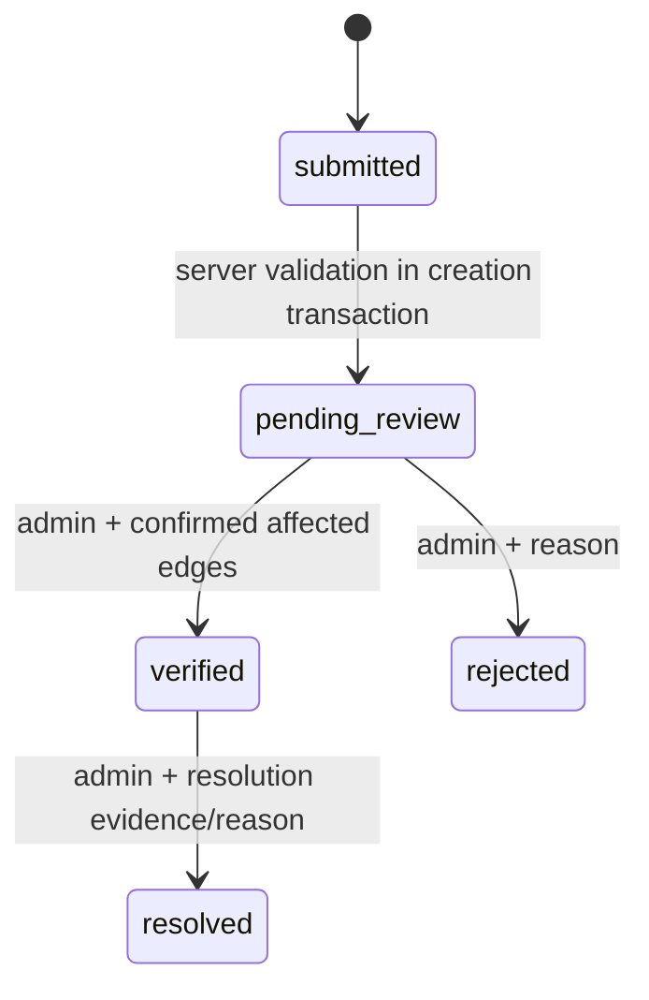

# Reporting, concurrency, and live graph updates

Implemented and tested through Phase 4; see [ADR-013](adr/013-phase4-reporting.md) and [Phase 4 evidence](PHASE4_TEST_EVIDENCE.md). Phase 1 graph version/audit primitives remain authoritative.

## Report lifecycle



Creation persists both submitted and pending_review history events in one transaction; successful API response is pending_review. There is no prolonged submitted queue or unsupported hidden worker. Rejected and resolved are terminal in v1; reopening requires a new linked report later, not an undocumented transition. Report content is immutable after submission; users can add/remove evidence only while pending. A verified report's evidence remains available for review/audit subject to the future privacy retention policy.

An admin confirms physical edge mappings and restriction kind when verifying. An unreviewed report, uploaded image, or accepted AI label has no direct effect on route eligibility. A verified obstacle must create at least one real edge restriction. Resolution releases only restrictions from that report. Infrastructure baseline status and other active restrictions continue to apply.

## Atomic mutation protocol

For verification/resolution and any graph-affecting infrastructure/path edit:

1. Authenticate, authorize, validate input and idempotency key. Compute canonical request hash. Claim unique `(actor,operation,key)` within the transaction; replays check payload equality before returning the stored authorized result.
2. Lock graph_state for the campus, then report/infrastructure/edge rows in the documented order. Recheck ownership, role, expected_version, and legal transition inside the transaction.
3. Resolve all affected physical edges, check same-campus mappings and provenance. For verification, insert active restrictions; for resolution, release only this report's restrictions. For baseline edits update measured/baseline records, not report-derived truth.
4. Increment row versions, append report history/admin_actions, increment graph_state.version **once per transaction**, and insert graph_events with the same version, affected edge IDs and reason. Update next_expiry_at. Use a DB-generated timestamp throughout.
5. Store idempotency response in the same transaction and commit. Any failure rolls back state, audit, event and response together. External notification occurs only after commit; SSE readers independently read committed events, so process death cannot lose the mutation.

Return 409 on stale expected_version or conflicting reused keys, 422 on illegal transitions/missing confirmed edges, and 503 on unavailable DB. Retrying an identical successful request returns the recorded response without another graph increment. Concurrent verify/reject attempts yield one committed transition and one conflict; they never produce both. Two distinct report verifications for one edge may both commit, preserving both restriction sources. Audit records include actor, request ID, before/after allowlisted values, reason and resulting graph version.

Graph-affecting actions include nodes/geometry, measurements, verification, physical retirement, infrastructure-edge mappings, baseline availability, active restrictions, cost/policy version and freshness expiry. Each uses the common service. Pure report submission/rejection and prediction review do not increment graph version unless they actually affect the graph. Seed creates version 1 and a reset event. A DB migration changing graph semantics must create a new version/reset event too.

## SSE protocol

`GET /api/v1/campuses/{id}/events`, `text/event-stream`, no buffering/caching; optional same-origin session cookie, no query-string tokens. Public payload contains only curated graph-change information. Each event:

```text
id: 42
event: graph.updated
data: {"campus_id":"<uuid>","graph_version":"42","changed_edge_ids":["<uuid>"],"reason":"report_verified","occurred_at":"<UTC timestamp>"}
```

Use per-campus graph version as SSE event ID, avoiding allocation-order/commit-order bugs from unrelated global sequences. Locking graph_state ensures same-campus commit order. Keep graph_events seven days. Initial connection without Last-Event-ID emits `graph.reset` at current version (reload graph/version); a valid retained cursor replays all committed later versions in order. An expired/missing/future/invalid cursor yields `graph.reset`, never silent resume from the wrong point. Duplicate events are allowed; versions <=current are ignored. Noncontiguous versions trigger reset/refetch. Heartbeat comments every 15s; client marks disconnected/stale after 45s without heartbeat. Poll committed events roughly once per second with bounded batches/connections; a broker is not required initially.

SSE disconnect is visible to users. On reconnect, refetch graph-version before declaring current, then recalculate against fresh backend data. A fetch-stream SSE client observes comment heartbeats and carries Last-Event-ID explicitly. Reconnect uses exponential backoff/jitter capped at 30 seconds. Close streams on page disposal/logout where appropriate. SSE failure must not consume all DB connections: short polling transactions, no long transaction per stream, and per-client connection caps.

## Client rerouting

Any newer campus graph version marks all displayed routes stale immediately. Recalculate active route even if the event's edge list does not intersect it: opening a new path may change the optimum. Edge intersection controls the urgent “route affected” wording only. Debounce bursts (250ms), cancel superseded requests, and ignore late responses whose source/profile request token differs or version is older than the client has observed. Preserve destination/profile, require explicit confirmation for new restrictions, and never silently relax preferences.

On 200 no_route, clear authoritative route guidance, retain origin/destination and explain constraints. On network/API failure hide authoritative route geometry and directions; retain trip inputs and explain loss of currentness. At route valid_until, expire the route locally and refresh even if SSE was lost. Fetch current version after tab resume and reconnect. A response verified just before a new transaction commits can become stale in transit; events/revalidation handle this, and UI language must never promise future safety.

## Failure scenarios and acceptance

| Scenario | Required observation |
| --- | --- |
| Crash before commit | No report/restriction/audit/version/event partial state |
| Crash after commit before push | Reconnect replays the committed durable graph event |
| Two admins submit opposing decisions | Exactly one wins; the other receives 409 and reloads |
| Resolve one of two hazards | Remaining restriction still blocks physical edge in both directions |
| Infrastructure mapping empty | Verification fails 422; no “verified” report without a routing effect |
| Expired accessibility survey | Expiry transaction marks needs_review, bumps version and notifies/revalidates |
| Duplicate SSE/review request | Idempotent client/server behavior, no duplicate restrictions/version increments |
| DB outage | No mutation succeeds; stale cached graph is not claimed current |

Phase 4 exercised these with independent DB connections, controlled clocks, injected failures and real browser rerouting. Exact coverage and remaining release limits are recorded in the evidence.

## Implemented bounds and maintenance

Creation/review/resolution use actor/resource-scoped UUID idempotency for 24 hours. Upload/delete use the pending report row version, with at most three processing/ready slots and 100 MiB normalized storage per user; uploads are not idempotent replays. A processing upload prevents verification until it completes or is rejected. Reports have immutable submitted content; private images are served only after owner/admin authorization.

Streams replay at most 100 revisions per batch, cap changed-edge IDs at 200 with `changes_truncated:true`, and admit three connections per identity and 200 globally. A reconnect with no new events receives an immediate heartbeat; later comments occur every 15 seconds. Short polling transactions refresh expiring 45-second leases. Startup and explicit owner CLI maintenance prune seven-day graph replay and 24-hour interrupted/orphan uploads while preserving ready files. Production scheduling and long-term privacy policy remain release work.

All newer campus revisions invalidate routes, even without edge intersection. Intersection only controls urgent wording. Authoritative cursor resets can replace an older cached counter and retire its connection epoch; callbacks from aborted campus/identity streams cannot overwrite the new scope. Queue/owner history/audit refresh every ten seconds for changes without graph events; analytics refresh every thirty seconds.
